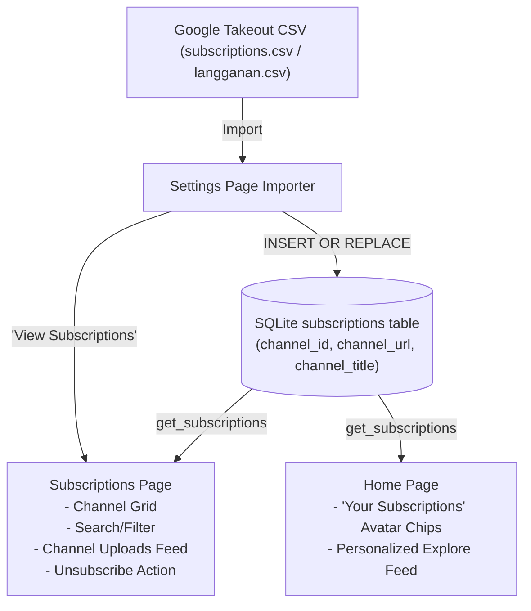

# MutsukiTube Design Specification: Subscriptions Page & Feed Integration

Date: 2026-10-29  
Status: **IN IMPLEMENTATION**  
Branch: `subscriptions-page-and-feed`  
Related Documents: [`docs/TRENDING_AND_DATA_IMPORT_DESIGN.md`](TRENDING_AND_DATA_IMPORT_DESIGN.md), [`docs/ISSUES.md`](ISSUES.md)

---

## 1. Executive Summary

Following the implementation of the Google Takeout Subscriptions CSV importer in MutsukiTube, this specification defines the end-to-end user experience for interacting with imported subscriptions:
1. **Dedicated "Subscriptions" Sidebar Navigation Destination**:
   - A primary top-level item between **Trending** and **Search** with a dedicated `subscriptions.svg` icon.
2. **Subscriptions Management & Video Browsing Page (`subscriptions-page.slint`)**:
   - Responsive grid of all subscribed channels with colorful initials/avatars, channel names, and direct channel links.
   - Live search/filtering of subscribed channels.
   - One-click channel video browsing: selecting any channel loads that channel's uploads feed.
   - Individual channel unsubscribe / delete action.
   - "Latest Feed" view pulling recent videos from your subscriptions.
3. **Home Page Subscriptions Shelf & Feed Integration**:
   - A horizontal "Your Subscriptions" shelf displaying avatar chips of subscribed channels for immediate access from the Home screen.
   - Exploring content from followed creators on the Home screen.
4. **Settings Page Quick Navigation**:
   - A direct link button ("View Subscriptions ›") from the Settings Import card to immediately view the imported channels.

---

## 2. Architecture & Data Flow



---

## 3. Data Layer Enhancements (`crates/mutsukitube-storage`)

In `crates/mutsukitube-storage/src/importer.rs`:
- `get_subscriptions() -> rusqlite::Result<Vec<SubscribedChannel>>`: (existing) Returns all channels sorted by title.
- `get_subscriptions_count() -> rusqlite::Result<usize>`: (existing) Fast `SELECT COUNT(*) FROM subscriptions`.
- `remove_subscription(channel_id: &str) -> rusqlite::Result<usize>`: (new) Deletes a single channel from the database.
- `is_subscribed(channel_id: &str) -> rusqlite::Result<bool>`: (new) Checks subscription status for any channel ID.

---

## 4. UI Layer Integration

### 4.1 Slint Data Structures (`ui/models.slint` or `app.slint`)
```slint
export struct ChannelItem {
    id: string,
    url: string,
    title: string,
    initials: string,
}
```

### 4.2 Sidebar Integration (`ui/components/sidebar.slint`)
- Icon: `ui/assets/subscriptions.svg`
- Route: `current-page == "subscriptions"`
- Callback: `nav-subscriptions()`

### 4.3 Subscriptions Page (`ui/pages/subscriptions-page.slint`)
- **Header**:
  - Title: "Subscriptions"
  - Subtitle: `X channels subscribed`
  - Filter input: `LineEdit` filtering channels in real-time.
  - Refresh button.
- **View Modes**:
  1. **Channels Grid**:
     - Visual channel card with high-contrast colored avatar circle and initials.
     - Full channel title and channel URL.
     - "Browse Videos" action button.
     - "Remove" button with confirmation.
  2. **Channel Videos View**:
     - `‹ Back to Channels` button.
     - Channel header with avatar, name, and total loaded videos.
     - Responsive grid of `GridVideoCard`s for video playback.
- **Empty State**:
  - Informative banner when 0 subscriptions exist with a direct button to "Open Settings to Import CSV".

### 4.4 Home Page Integration (`ui/pages/home-page.slint`)
- In `HomePage`:
  - `in property <[ChannelItem]> subscribed-channels;`
  - When `subscribed-channels.length > 0`:
    - Displays a horizontal scrolling shelf of Channel avatar chips with title labels.
    - Clicking any chip navigates to that channel's video feed.
    - "View All (X) ›" button jumps to the Subscriptions page.

---

## 5. Navigation & State Management (`apps/desktop/src/navigation.rs`)

```rust
pub enum NavRoute {
    YouTubeHome,
    YouTubeTrending { category: String },
    YouTubeSubscriptions { channel_id: Option<String>, channel_title: Option<String> },
    YouTubeSearch { query: String },
    // ...
}
```
Preserves channel browsing state across back-navigation (`Subscriptions -> WatchPage -> Back` returns directly to the channel view without re-fetching).

